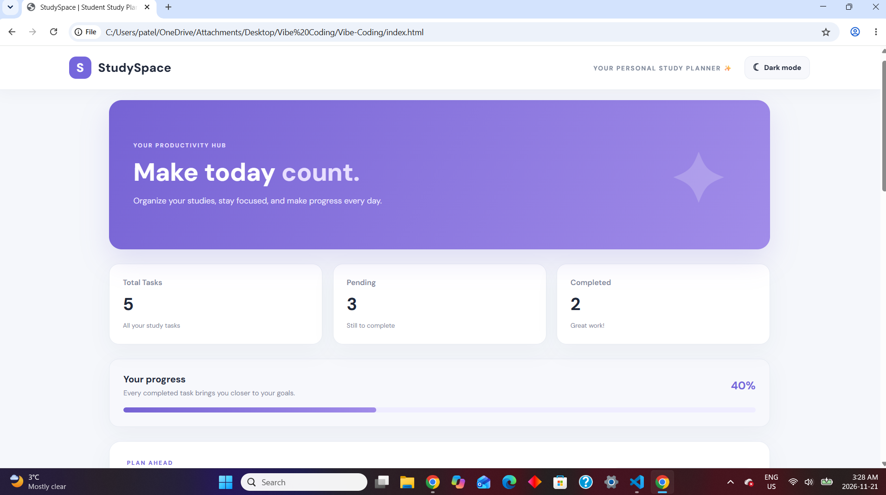
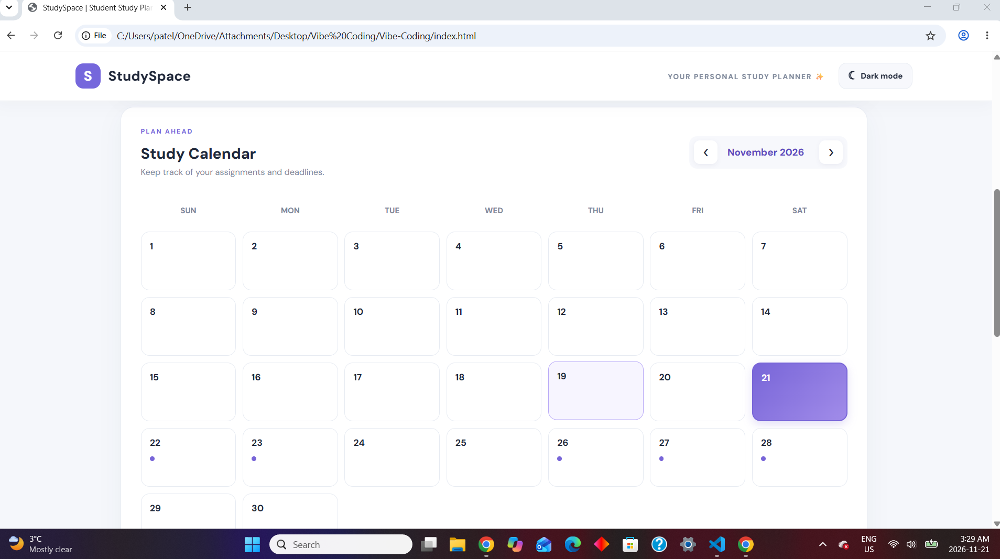

# StudySpace – Student Study Planner

## Project Description

StudySpace is a student study planner designed to help students organize their academic tasks, manage deadlines, track their progress, and maintain a more structured study routine.

The application provides a simple dashboard where users can create, update, complete, delete, and organize tasks. It also includes a calendar view and a light/dark theme option.

## Purpose

The purpose of StudySpace is to make managing schoolwork easier by bringing important tasks and deadlines into one organized workspace.

It was created as part of the Vibe Coding Challenge to demonstrate how AI-assisted development can be used to plan, build, test, and improve a functional application.

## Features

- **Task Management:** Add, edit, complete, and delete study tasks.
- **Task Details:** Include task titles, subjects, due dates, and priorities.
- **Task Filters:** View all tasks, pending tasks, or completed tasks.
- **Progress Tracking:** View task statistics and completion progress.
- **Calendar:** Navigate between months and view scheduled tasks by date.
- **Deadline Awareness:** Identify overdue tasks and organize tasks by due date.
- **Theme Toggle:** Switch between light and dark themes.
- **Data Persistence:** Tasks and theme preferences are saved using browser Local Storage, so they remain available after refreshing the page.

## Technologies Used

- HTML5 – Application structure.
- CSS3 – Layout, styling, and responsive design.
- JavaScript – Application functionality and interactions.
- Browser Local Storage – Saving tasks and theme preferences.
- Visual Studio Code – Development environment.
- Git and GitHub – Version control and project hosting.
- ChatGPT – AI-assisted planning, coding, debugging, and improvement.

## How to Run the Application

StudySpace is a front-end application and does not require a backend server or package installation.

1. Download or clone this repository.
2. Open the project folder in Visual Studio Code.
3. Open `index.html` using the Live Server extension, or open the file directly in a web browser.
4. Start using StudySpace.

No additional dependencies or API keys are required.

## How AI Was Used

ChatGPT was used throughout development to help plan the application, generate and improve code, troubleshoot issues, and introduce new features.

Development was completed in multiple iterations:

- **V1 – Core Dashboard:** Created the basic dashboard, task creation, completion and deletion, filters, progress statistics, and Local Storage.
- **V2 – Task Management:** Improved task management by adding editing functionality, due-date organization, and overdue task indicators.
- **V3 – Calendar:** Added a calendar interface, month navigation, date selection, and task indicators.
- **V4 – UI Upgrade:** Improved the visual presentation and added a light/dark theme toggle with saved theme preferences.

### Three Significant AI Prompts

The following are summaries of significant prompts used during development, rather than exact verbatim transcripts.

**Prompt 1 – Building the Core Application**

"Help me build a student study planner called StudySpace using HTML, CSS, and JavaScript. Create a dashboard where students can add, complete, and delete tasks. Include subjects, priorities, due dates, task filters, progress statistics, and Local Storage so tasks remain saved after refreshing."

**Prompt 2 – Improving Task Management**

"Improve the existing StudySpace application by adding the ability to edit tasks. Include save and cancel actions, organize tasks by due date, and identify overdue tasks. Preserve the existing features and Local Storage functionality."

**Prompt 3 – Adding the Calendar and Theme Upgrade**

"Continue improving StudySpace by adding a calendar with month navigation and selectable dates. Show tasks associated with dates. Then improve the interface with a light/dark theme toggle and save the user's theme preference using Local Storage. Keep the existing task functionality working."

## Screenshots

The following screenshots demonstrate the application.

Add your actual screenshots to a folder named `screenshots` in the project.

### Main Dashboard



### Calendar View



## Vibe Coding Reflection

### 1. What did AI do particularly well?

AI helped generate the initial application structure and implement features more quickly. It was especially useful for creating JavaScript functionality, improving the interface, and breaking the project into smaller development stages.

### 2. What did AI do poorly?

Some generated code required corrections and adjustments. For example, a CSS issue involving a mobile media query affected the calendar layout. This showed me that AI-generated code is not always correct on the first attempt.

### 3. How did you verify AI-generated code?

I tested the application in a web browser and checked its main features, including task creation, editing, deletion, completion, filtering, calendar navigation, and theme switching. I also refreshed the page to check whether saved information and the selected theme remained available.

### 4. How did your prompts evolve?

My prompts became more specific as the project developed. I started with a basic study planner and then requested improvements to task management, calendar functionality, and the user interface. I also learned to explain which existing features needed to be preserved when adding new ones.

### 5. What did you learn?

I learned how HTML, CSS, and JavaScript work together to create a web application. I also gained experience with Local Storage, debugging, testing, GitHub, and breaking a larger project into smaller improvements. Most importantly, I learned that understanding and checking AI-generated code is part of the development process.

### 6. Would you trust AI to build the entire application without human supervision? Why or why not?

No. AI is useful for generating code and speeding up development, but it can make mistakes or introduce problems. Human supervision is important for testing features, checking the code, identifying issues, and ensuring that the application works as intended.

## Future Improvements

1. Add user accounts so students can access their study plans across multiple devices.
2. Add notifications and reminders for upcoming deadlines.
3. Add weekly and monthly study reports with more detailed progress statistics.
4. Add the ability to export or back up tasks.
5. Improve accessibility and test the layout on more screen sizes.

## Project Structure

```text
Vibe-Coding/
│
├── index.html
├── style.css
├── script.js
├── README.md
├── PROMPT.md
├── .gitignore
│
└── screenshots/
    ├── dashbordmainandprogress.png
    ├── dashbordtasks.png
    ├── calendar.png
    └── calendar2.png
```

## Author

Created as a student project for the Vibe Coding Challenge.
